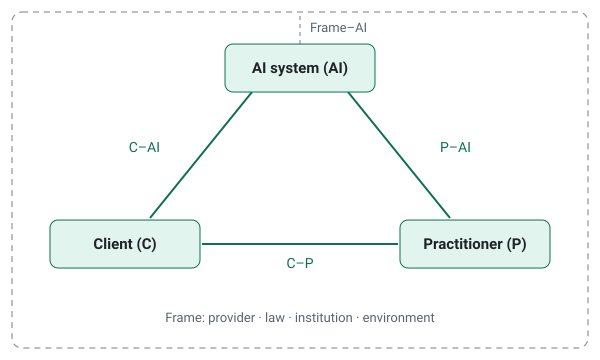

# ANIMA – AI Navigator for Informed Mental Health Applications

[](https://doi.org/10.5281/zenodo.24138892)

**An open European framework for AI in psychology.**

ANIMA shows **what applies**, **what is recommended** and **what is known** when AI enters psychological work or affects people psychologically. Every source is placed on one model: the **triad of client, practitioner and AI system**.



ANIMA is a navigator, not a norm. It helps people find their way through the requirements; it does not replace them.

> **Status: v0.2.0 – structure complete.** The model, methodology and data format are in place. Sources are listed as candidates and have not yet been summarised. All content is `draft` until reviewed by a second person. Contributions are welcome – see [CONTRIBUTING.md](CONTRIBUTING.md).

## What ANIMA covers

1. **Psychology as a profession** – psychologists who use AI in their work, or whose clients use AI: clinical and health psychology, psychological assessment, expert opinions, work, school and traffic psychology.
2. **Psychological effects of AI** – how AI systems affect people's experience and behaviour, for example trust, dependence, wellbeing or decisions. This includes the use of AI **without any practitioner**, such as chatbots or wellness apps.

Psychotherapy and psychiatry are not covered as professions; their settings are covered where psychological effects of AI are concerned. Details: [docs/scope.md](docs/scope.md).

## How it works

| Question | Pillar | Examples |
|---|---|---|
| **What applies?** | [Law](sources/law/) | EU AI Act, GDPR, Medical Device Regulation, national professional law |
| **What is recommended?** | [Guidance](sources/guidance/) and [professional standards](sources/professional/) | WHO, European Commission, NICE; EFPA, American Psychological Association |
| **What is known?** | [Evidence](evidence/) *(planned)* | studies and reviews, rated following GRADE |

Each requirement from these sources is placed on the [triad](model/README.md): which relationship it concerns (e.g. client – AI system), what it regulates (information, influence, relationship, responsibility), in which situation it takes effect (e.g. a person alone with a chatbot) and **who must act**. The [navigator](navigator/) brings all requirements together and shows the **gaps** – where no source assigns any duty.

## Who is it for?

- **Psychologists** who use AI or whose clients use it
- **Institutions** – clinics, universities, schools, employers – that decide on AI use or write guidelines
- **Developers and providers** of AI systems with psychological effects, including wellness apps and chatbots
- **Researchers, regulators and professional bodies** working on AI in psychology
- **People who use AI on their own** and want to know what protects them

## Website

The framework can also be read at **https://j0hnhaas.github.io/anima-framework/**.

## Repository structure

```
├── model/             the triad: client, practitioner, AI system
├── sources/
│   ├── law/           binding law
│   ├── guidance/      WHO, public bodies, authorities
│   └── professional/  professional bodies of psychologists
├── search/            search log, candidate register, search flow
├── evidence/          research (planned)
├── navigator/         all requirements on the triad, with gaps (generated)
├── data/              navigator as JSON and CSV (generated)
├── docs/              scope, methodology, vocabulary, search protocol
├── templates/         template for source files
├── schema/            JSON Schema for source files
├── scripts/           validation and navigator generator
└── references.bib     central bibliography
```

## Documentation

| Document | Content |
|---|---|
| [Model: the triad](model/README.md) | Client, practitioner and AI system – the model every source is mapped onto |
| [Scope and definitions](docs/scope.md) | What ANIMA covers, pillars of sources, spectrum, definitions |
| [Methodology](docs/methodology.md) | How sources are selected, mapped onto the triad, verified and updated |
| [Controlled vocabulary](docs/vocabulary.md) | All codes: pillars, jurisdictions, bindingness, triad, topics, status |
| [Search protocol](docs/search-protocol.md) | How sources are searched, screened and selected (scoping-review practice) |
| [Search](search/README.md) | Search log, candidate register and flow of the search |
| [Sources](sources/README.md) | Where source files go |
| [Navigator](navigator/README.md) | How requirements are brought together; coverage and gaps |
| [Source template](templates/source-summary.md) | Structure every source file follows |
| [Contributing](CONTRIBUTING.md) | How to contribute and check your contribution, DCO |
| [Governance](GOVERNANCE.md) | Roles, decision making, build-up phase, conflicts of interest |
| [Code of conduct](CODE_OF_CONDUCT.md) | How we work together |
| [Security](SECURITY.md) | How to report personal data or sensitive problems |
| [Changelog](CHANGELOG.md) | Changes per version, with DOIs |

## Languages

The framework is written in **English** so it can be used across Europe. National sources may be quoted in their original language (e.g. German for Austria) with an English summary.

## How to cite

If you use ANIMA, please cite it. The citation metadata is in [CITATION.cff](CITATION.cff); GitHub shows a ready-made citation under **"Cite this repository"** in the sidebar.

> Haas, J. G. (2026). *ANIMA – AI Navigator for Informed Mental Health Applications* [Data set]. Zenodo. https://doi.org/10.5281/zenodo.24138892

This DOI always points to the latest version. Every release is archived on [Zenodo](https://doi.org/10.5281/zenodo.24138892) with its own version DOI; use that one if you need to cite a specific version.

| Version | DOI |
|---|---|
| 0.2.0 | [10.5281/zenodo.24145323](https://doi.org/10.5281/zenodo.24145323) |
| 0.1.0 | [10.5281/zenodo.24138893](https://doi.org/10.5281/zenodo.24138893) |

## Maintainer

**Mag. John G. Haas** – initiator and maintainer · ORCID [0000-0002-4591-5015](https://orcid.org/0000-0002-4591-5015)

## Acknowledgements

The initial structure and documentation of ANIMA were drafted with the assistance of AI models – Claude (Anthropic) and ChatGPT (OpenAI) – and reviewed, revised and approved by the maintainer. AI models are tools, not authors; responsibility for all content lies with the maintainers. Content is verified against the original sources in accordance with the [methodology](docs/methodology.md#9-use-of-ai-tools).

## Licence

- **Content** (texts, model, source files): [CC BY 4.0](LICENSES/CC-BY-4.0.txt)
- **Data** (`data/`): [CC0 1.0](LICENSES/CC0-1.0.txt)
- **Code** (scripts, schema, website layout): [EUPL-1.2](LICENSES/EUPL-1.2.txt)

Licences are assigned per file in [REUSE.toml](REUSE.toml), following the [REUSE](https://reuse.software) specification of the FSFE.

Sources keep their own licences – WHO documents, for example, usually CC BY-NC-SA 3.0 IGO. ANIMA therefore summarises sources in its own words, quotes only briefly and links to the original.

## Disclaimer

ANIMA is an **independent initiative**. It is not affiliated with, endorsed by or acting on behalf of the WHO, the European Union, any national authority or any professional body.

The content is provided for orientation only. It is **not legal advice** and **not a treatment recommendation**. Always check the original sources and, where needed, consult qualified professionals.

## Kurzfassung (Deutsch)

ANIMA ist ein offenes europäisches Framework für KI in der Psychologie. Es zeigt, **was gilt**, **was empfohlen wird** und **was bekannt ist**, wenn KI in die psychologische Arbeit eintritt oder Menschen psychologisch beeinflusst. Alle Quellen – Recht, Empfehlungen öffentlicher Stellen und Standards von Berufsverbänden – werden auf einem Modell verortet: der Triade aus Klient:in, Practitioner und KI-System. ANIMA ist eine unabhängige Initiative und stellt keine Rechtsberatung und keine Behandlungsempfehlung dar.
