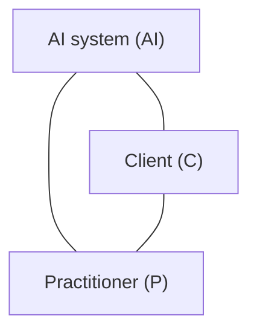

# The ANIMA model: the triad

ANIMA places every source and every requirement on one model: the **triad of client, practitioner and AI system**. This document defines the model. How sources are mapped onto it is described in the [methodology](../docs/methodology.md); the codes are listed in the [vocabulary](../docs/vocabulary.md).

*The triad sits inside a **frame**: provider, law, institution and environment (section 5).*

## Why a triad

Psychological work has long been described as a relationship between two people: the person seeking help or being assessed, and the psychologist. When an AI system enters this relationship, it becomes a triad. The AI system can work with the practitioner, with the client, or with both – and sometimes without one of them knowing.

The triad lets ANIMA ask the same questions of every source: *Which relationship does a requirement concern? What flows through it? In which situation does it apply? Who must act?*

## 1. Nodes

| Node | Definition | Examples |
|---|---|---|
| **Client (C)** | The person with or about whom psychological work is done, or who is psychologically affected by an AI system. | a client in counselling; a patient in clinical-psychological treatment; a test taker; an applicant in aptitude assessment; a person who uses a chatbot on their own |
| **Practitioner (P)** | A psychologist who carries professional responsibility for the psychological work. | clinical psychologist, health psychologist, work or school psychologist |
| **AI system (AI)** | An AI system as defined in Art. 3(1) of the EU AI Act. The node stands for the **system**, not for the company behind it. | chatbot, scoring or assessment software, transcription tool, wellness app |

- **Groups:** in couple, family or group settings, the node C stands for the group. Other people concerned belong to the environment (section 5).
- **Commissioning parties** – for example an employer that orders an aptitude assessment or a court that orders an expert opinion – are not clients. They belong to the institution (section 5).
- **The provider** of an AI system belongs to the frame, not to the node AI. Properties that result from a business model (data use, design for engagement) are thus attributed to the provider, not to the technology.

## 2. Edges

| Edge | Relationship | Typical situations |
|---|---|---|
| **C–P** | Professional relationship between client and practitioner | counselling, assessment, treatment, expert opinion |
| **C–AI** | The client uses the AI system directly, or the client's data flows into it | chatbot, self-help app, online questionnaire with automated feedback |
| **P–AI** | The practitioner uses the AI system as a tool and oversees it | AI-assisted documentation, test scoring, report drafts, literature research |
| **Frame–AI** | The output serves the organisation or third parties rather than a specific psychological service | applicant pre-selection by an employer, administration, quality assurance, research |

## 3. Flows

Each edge carries four flows. A requirement usually concerns one or two of them.

| Flow | Question | Examples of topics |
|---|---|---|
| **Information** | What is disclosed, processed and returned – and who knows about it? | transparency, data protection, accuracy of outputs |
| **Influence** | Who or what shapes decisions, behaviour or self-image? | manipulation, automation bias, persuasive design |
| **Relationship** | How do trust, attachment and the working alliance change? | dependence, substitution of human contact, trust calibration |
| **Responsibility** | Who is accountable, who must act, who is liable? | professional duties, human oversight, liability |

## 4. Configurations

The triad is often incomplete. Which edges are active, missing or hidden defines the **configuration**.

| No. | Configuration | Active edges | Example |
|---|---|---|---|
| **1** | **Full triad, open** | C–P, C–AI, P–AI | A psychologist recommends an app and follows its use with the client. |
| **2** | **Practitioner-supported** | C–P, P–AI; the client is a data source and knows about it | AI-assisted scoring of a questionnaire the client has completed |
| **3** | **Client alone with the AI** | C–AI only | A person uses a general-purpose chatbot for emotional support or a wellness app. |
| **4** | **Client uses AI covertly** | C–P, C–AI; P is unaware | A client discusses their sessions with a chatbot without telling the psychologist. |
| **5** | **Practitioner uses AI covertly** | C–P, P–AI; C is unaware | A psychologist drafts a report with AI without informing the client. |
| **6** | **No direct client contact** | P–AI or Frame–AI; C is affected but not involved | Automated screening of applicants; analysis of records |

Configurations 1, 2, 3 and 6 describe intended uses. Configurations 4 and 5 describe deviations in practice; they matter because requirements that rely on knowledge of the AI use (e.g. consent) cannot take effect there.

A **missing or hidden edge is itself a finding**. In configuration 3, for example, no practitioner is present, so requirements addressed to practitioners do not apply.

## 5. Frame

| Element | Question | Examples |
|---|---|---|
| **Provider** | Who develops or operates the AI system, and with which business model? | developer, platform, cloud service; in the AI Act: provider |
| **Law** | What binding rules apply? | EU and national law – the sources of the law pillar |
| **Institution** | Who decides on, pays for or commissions the use? | employer, clinic, school, insurer, court; in the AI Act often: deployer |
| **Environment** | Who else is affected? | parents of minors, partners and family, third parties who are talked about |

## 6. Addressee

ANIMA adds one element to the triad: the **addressee** of a requirement – the party that must act.

| Addressee | Meaning |
|---|---|
| `practitioner` | the psychologist (node P) |
| `provider` | the developer or operator of the AI system (frame) |
| `institution` | the organisation that deploys, pays for or commissions the AI use (frame) |
| `authority` | legislators, regulators, supervisory bodies (frame) |
| `client` | the client, where a source addresses them directly, e.g. guidance for the public |

The client is usually the party a requirement **protects**. Where a source addresses clients directly, `client` is used as addressee.

## 7. Mapping a requirement – illustrative examples

The following examples show the form of a mapping. They are illustrations, not verified content.

| Requirement | Edge | Flow | Configurations | Addressee |
|---|---|---|---|---|
| People must be informed that they are interacting with an AI system (cf. EU AI Act, Art. 50) | C–AI | Information | 1, 3, 4 | provider |
| Clients must be informed about the methods used in their assessment or treatment (cf. professional law and codes of ethics) | C–P | Information, Responsibility | 2, 5 | practitioner |

Placing many requirements on the triad makes **gaps** visible: edges, flows or configurations for which no source assigns any duty.

## 8. Limitations

- **The triad is not a hierarchy of equals.** An AI system cannot bear responsibility. Responsibility always lies with people or organisations: the practitioner, the provider, the institution or the authority.
- **Mapping is a judgement.** Two people may place the same requirement differently. Mappings are therefore reviewed by a second person (see the methodology).
- **AI systems change.** A product update can move a system from one configuration or edge to another. Mappings are dated.
- **Multi-person settings** stretch the model. They are handled as described in section 1.

## 9. Origin

The idea of AI as a "third" in a professional relationship has been described in the literature. Haber, Levkovich, Hadar-Shoval and Elyoseph (2024) introduced the term **"artificial third"** for the presence of generative AI in the psychotherapeutic relationship and discussed its effects on transparency and autonomy.

ANIMA builds on this idea and extends it in three ways: from psychotherapy to **psychological work in general**, to the use of AI **without any practitioner**, and with **structural elements** – flows, configurations, frame and addressee – that allow requirements from law, guidance and professional standards to be located precisely.

## References

Haber, Y., Levkovich, I., Hadar-Shoval, D., & Elyoseph, Z. (2024). The artificial third: A broad view of the effects of introducing generative artificial intelligence on psychotherapy. *JMIR Mental Health, 11*, e54781. https://doi.org/10.2196/54781
